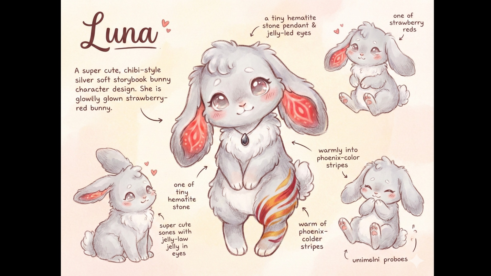
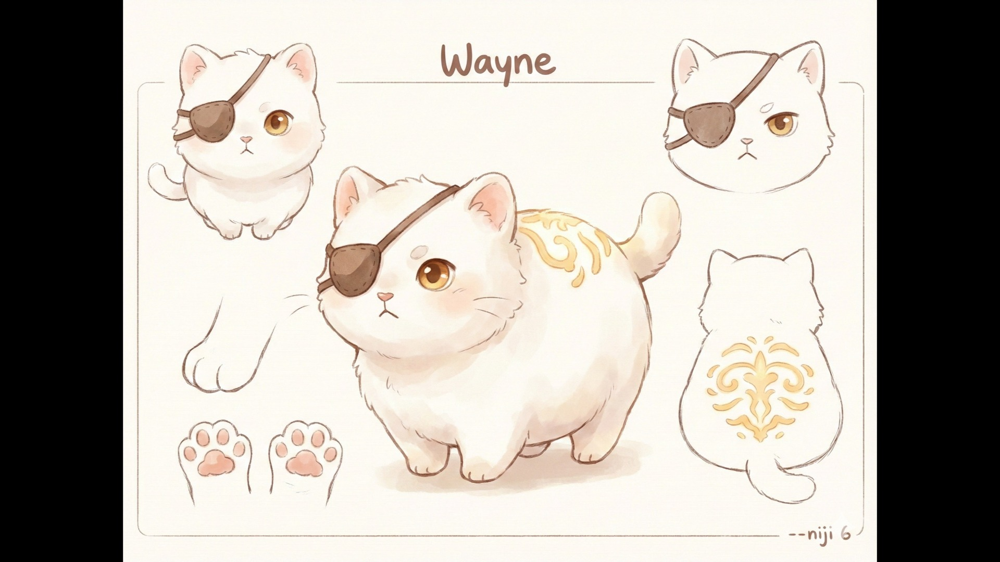
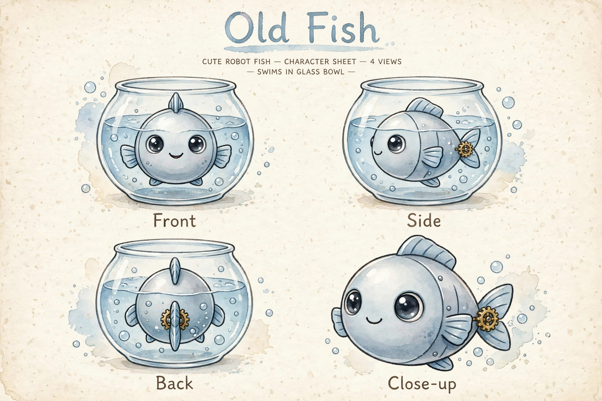

# Character Cards — Luna, Wayne, and Old Fish

These three pictures are the source of truth for how the characters look.
Every drawing and video in this trip must match them.

## Luna

- Silver-grey soft chibi bunny, long floppy ears **hanging down**.
- Red-orange phoenix pattern inside the ears; phoenix-colour tiger
  stripes on a hind leg; tiny hematite teardrop pendant; rosy blush.
- In the trip she wears a red Christmas scarf.
- She is the excited explorer.
- Voice: Paloma (always the same voice, never changes).

## Wayne

- Chubby white cat with **ONE** brown eyepatch — never two.
- The eyepatch is on the **left side of the picture**; his open eye is
  **bright golden yellow** on the right side.
- Gold swirl on his back; red Christmas scarf.
- He is friendly and cares about his friends — he worries
  "Do not drop my bowl" about Old Fish. He is NOT grumpy.
- He normally appears only in the background, small, exactly once per
  panel.
- Voice: Miles (always the same voice, never changes).

## Old Fish

- Small, round and chubby cute robot fish, soft pastel silver-blue
  metal, fish tail fin, top fin, big round shiny eye, tiny happy smile.
- **One tiny brass gear on his tail only.** No ears, no paws, no legs,
  no whiskers, no eyepatch.
- Always in his round glass bowl, exactly once per panel.
- He is the little scientist who loves numbers and calculates the
  trip costs.
- Voice: Caitlin (always the same voice, never changes).
